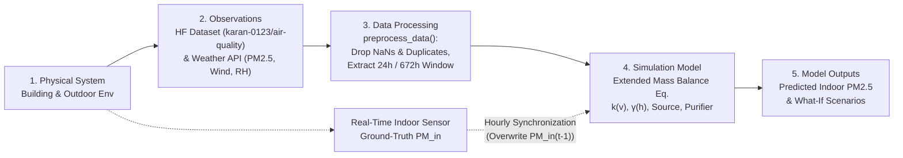

# System Model Specification: Indoor Air Quality (**PM2.5**) Digital Twin

**Project Title:** Digital Twins – Indoor Air Quality (**PM2.5**) Simulation  
**Team Members:** Frendl Krisztián & Kozicz Gergő  
**Prototype Category:** Monitoring, Reporting, and Verification (MRV) Digital Twin  

---

## 1. Modelling Purpose & Scope

The primary objective of this Digital Twin prototype is to monitor, simulate, and predict indoor fine particulate matter (**PM2.5**) concentrations within a building room under dynamic environmental and operational conditions.

* **Core Modelling Question:** How does indoor **PM2.5** concentration (**PM_in**) evolve over a given period (24-hour daily cycle and 1-month horizon) under varying outdoor air pollution (**PM_out**), wind speed (**v**), and relative humidity (**h**) conditions?
* **What-If Scenario Analysis:** How do changes in building airtightness (Scenario A), artificial humidification accelerating particle settling (Scenario B), internal emission events such as cooking (Scenario C), active air purification (Scenario D), and extreme stormy drafts combined with indoor emissions and filtration (Scenario E) impact indoor air quality?
* **Decision Support & Control Objective:** How should indoor air quality control devices (air purifier CADR **β_purifier**, humidifier) and building ventilation/insulation be operated to maintain safe indoor **PM2.5** levels while minimizing energy consumption and human exposure?

---

## 2. System Boundary & Physical Decomposition

The system model separates the indoor micro-environment from external meteorological and behavioral drivers:

| Boundary Domain | Included Elements & Processes |
| :--- | :--- |
| **Inside the System (Indoor Room Volume)** | • **Indoor Air State:** Current indoor particulate matter concentration **PM_in(t)** • **Dynamic Infiltration Process:** Wind-driven outdoor-to-indoor particle penetration **k(v) · (PM_out - PM_in)** • **Gravitational Deposition Process:** Humidity-dependent particle growth and settling **γ(h) · PM_in** • **Internal Emission Process:** Occupant-generated pollution **α_source** • **Active Filtration Process:** Clean Air Delivery Rate (CADR) removal via air purifier **β_purifier** |
| **Outside the System (External Drivers)** | • **Meteorological & Pollution Disturbances:** Outdoor **PM2.5** concentration (**PM_out**), wind speed (**v**), and ambient relative humidity (**h**) • **Occupant Activity Schedule:** Timing and intensity of cooking, cleaning, or room occupancy • **Control Commands:** Air purifier power/settings and humidifier operation |
| **System Outputs** | • Hourly predicted and synchronized indoor **PM2.5** concentration **PM_in(t)** in **µg/m³** • Multi-scenario comparative trajectories and daily/monthly exposure averages |

---

## 3. System Variables & Parameters

All system quantities are formally classified according to the Digital Twin state-space framework:

| Category | Symbol | Code Variable | Unit | Baseline Value | Description |
| :--- | :--- | :--- | :--- | :--- | :--- |
| **State (x_t)** | **PM_in(t)** | `PM_in` | **µg/m³** | **x_0 = 15.0** | Current indoor **PM2.5** concentration carrying system memory across time steps. |
| **Control (u_t)** | **β_purifier** | `beta_purifier` | **µg/(m³·h)** | **0.0** | Active air purifier filtration rate (CADR removal). |
| **Control (u_t)** | **α_source** | `alpha_source` | **µg/(m³·h)** | **0.0** | Controllable/schedulable indoor pollution generation (e.g., cooking, cleaning). |
| **Control (u_t)** | **c_h** (active) | `c_h` | **h⁻¹·%⁻¹** | **0.001** | Artificial humidity control via humidifier to accelerate particle settling. |
| **Disturbance (d_t)** | **PM_out(t)** | `pm25` | **µg/m³** | *Time-series* | Uncontrolled outdoor **PM2.5** concentration entering via infiltration. |
| **Disturbance (d_t)** | **v(t)** | `wind` | **m/s** | *Time-series* | Outdoor wind speed increasing pressure across the building envelope. |
| **Disturbance (d_t)** | **h(t)** | `rh` | **%** | *Time-series* | Relative humidity influencing hygroscopic particle growth and deposition. |
| **Parameter (θ)** | **k_base** | `k_base` | **h⁻¹** | **0.1** | Base building envelope infiltration rate in calm conditions (**v = 0**). |
| **Parameter (θ)** | **c_w** | `c_w` | **(m/s)⁻¹·h⁻¹** | **0.05** | Wind sensitivity coefficient for dynamic air infiltration. |
| **Parameter (θ)** | **c_h** | `c_h` | **h⁻¹·%⁻¹** | **0.001** | Humidity deposition coefficient characterizing gravitational settling. |
| **Parameter (θ)** | **Δt** | `delta_t` | **h** | **1.0** | Discrete simulation and synchronization time step (1 hour). |
| **Observation (y_t)** | **y_out, y_in** | `pm25`, `rh`, `wind` | Various | *Measured* | Sensor readings of indoor/outdoor **PM2.5**, **PM10**, RH, temperature, wind, rain, and gases (**NO2, CO, SO2, O3**). |

---

## 4. Mathematical & Behavioral Formulation

The core simulation engine (`simulate_advanced_indoor_aq`) implements a discrete-time **Extended Mass Balance Equation** over an hourly time step (**Δt = 1 h**).

### 4.1. Dynamic Physical Coefficients
At each time step **t**, the infiltration rate **k(v_t)** and deposition rate **γ(h_t)** are computed dynamically from environmental inputs:

**k(v_t) = k_base + c_w · v_t**

**γ(h_t) = c_h · h_t**

### 4.2. State-Space Transition Equation
The net hourly change in indoor particulate matter **ΔPM_in(t)** is governed by the balance of infiltration, deposition, internal generation, and active filtration:

**ΔPM_in(t) = Δt · [ k(v_t) · (PM_out(t) - PM_in(t-1)) - γ(h_t) · PM_in(t-1) + α_source - β_purifier ]**

To guarantee physical validity (non-negative concentrations), the state update applies a lower bound at zero:

**PM_in(t) = max(0, PM_in(t-1) + ΔPM_in(t))**

---

## 5. Digital Twin Architecture & Synchronization

### 5.1. End-to-End Architecture Flow

### 5.2. Pipeline Components & Data Sources
1. **Historical & Real-Time Data Layer:**
   * **Historical Baseline:** Publicly available hourly dataset from Hugging Face (`karan-0123/air-quality`, **87,672 × 11** records).
   * **Real-Time APIs:** *OpenWeatherMap API* for live outdoor meteorological boundary conditions (`wind`, `rh`, `pm25`) and *OpenAir Foundation / Physical Optical Laser Particle Sensor* for indoor ground-truth measurements. **Still in Progress**
2. **Automated Preprocessing (`preprocess_data`):** Filters out incomplete records via `dropna()`, removes duplicate timestamps using `drop_duplicates(subset=['datetime'], keep='first')`, resets index continuity, and slices evaluation windows (**24 h** daily or **672 h** monthly).
3. **Hourly State Synchronization Mechanism:** (**Still in Progress, just plans**)
   * **Synchronization Variable:** Measured indoor **PM2.5** concentration (**PM_in,obs**).
   * **Update Frequency:** Hourly (**Δt = 1 h**), matching sensor telemetry and dataset resolution.
   * **Drift Elimination (Direct State Overwrite):** When a new ground-truth indoor measurement arrives at step **t-1**, the model overwrites its internal prior state **PM_in(t-1) ← PM_in,obs(t-1)** before computing the forward prediction **PM_in(t)** using incoming outdoor measurements. This prevents cumulative integration drift.

---

## 6. What-If Scenarios & Validation Summary

### 6.1. Configured Simulation Scenarios
The model evaluates six distinct operational and environmental regimes:

| Scenario ID | Scenario Name | **k_base** | **c_w** | **c_h** | **α_source** | **β_purifier** | Physical Interpretation |
| :--- | :--- | :---: | :---: | :---: | :---: | :---: | :--- |
| **Baseline** | Normal Conditions | **0.1** | **0.05** | **0.001** | **0.0** | **0.0** | Standard insulated room with no internal sources or active filtration. |
| **Scenario A** | Drafty House | **0.3** | **0.10** | **0.001** | **0.0** | **0.0** | Poor insulation and high wind sensitivity driving rapid outdoor particle ingress. |
| **Scenario B** | Humidifier ON | **0.1** | **0.05** | **0.005** | **0.0** | **0.0** | Elevated indoor humidity accelerating gravitational particle settling. |
| **Scenario C** | Cooking Event | **0.1** | **0.05** | **0.001** | **12.0** | **0.0** | Strong continuous internal pollution source without air purification. |
| **Scenario D** | Cooking + Purifier | **0.1** | **0.05** | **0.001** | **12.0** | **15.0** | Active air purifier (**β > α**) mitigating cooking emissions. |
| **Scenario E** | Stormy Draft | **0.5** | **0.20** | **0.001** | **12.0** | **15.0** | Stress test: extreme wind infiltration and cooking against active filtration. |

### 6.2. Key Behavioural Findings (Simulation vs. Observation)
* **Low-Pass Filtering & Phase Delay:** Simulated indoor **PM2.5** trajectories are significantly smoother and exhibit a temporal lag compared to raw outdoor observations (**PM_out**), accurately reflecting the buffering capacity of the building envelope (**k(v)**) and natural indoor deposition (**γ(h)**).
* **Assumptions & Limitations:** The model assumes a well-mixed single-zone indoor air volume (lumped-parameter approximation) and unmeasured physical coefficients (**k_base, c_w, c_h**) that require empirical calibration against paired indoor-outdoor sensor logs.
